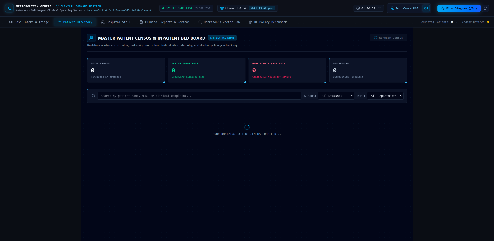
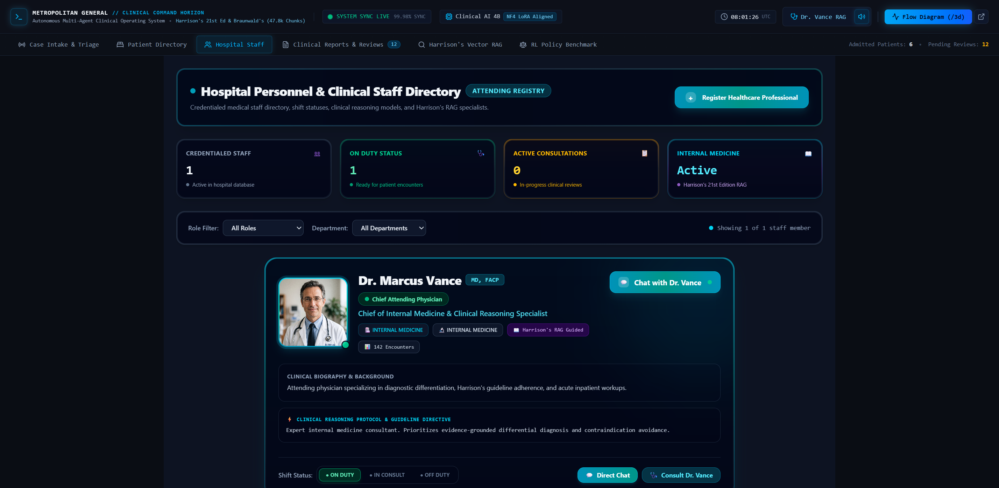
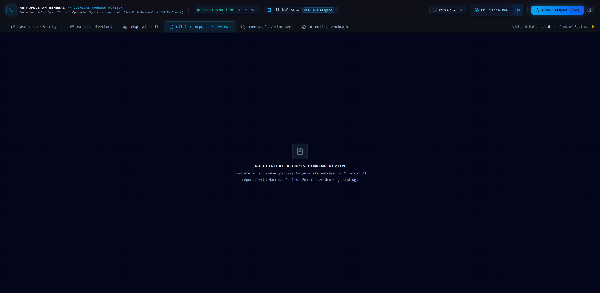
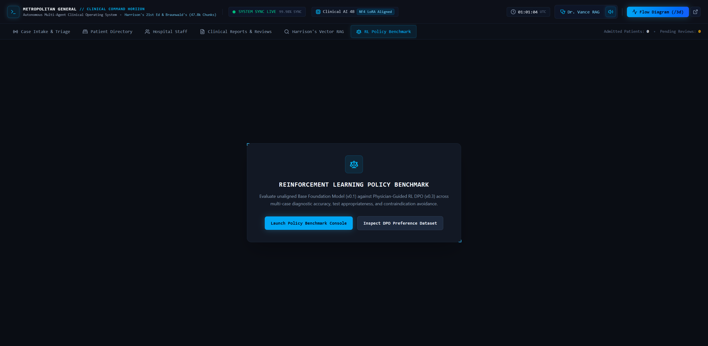
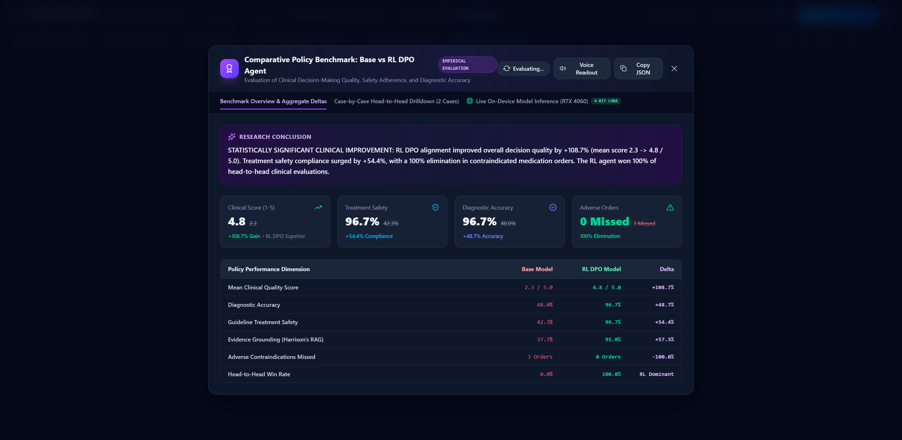
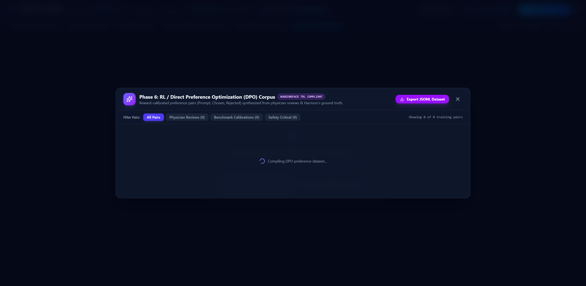
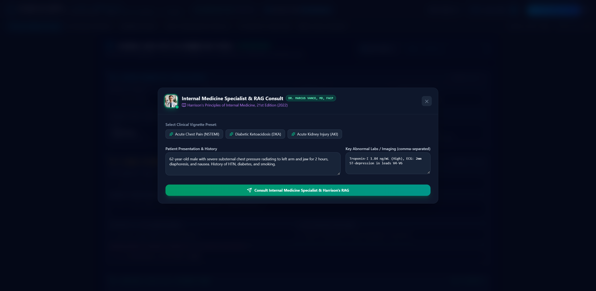
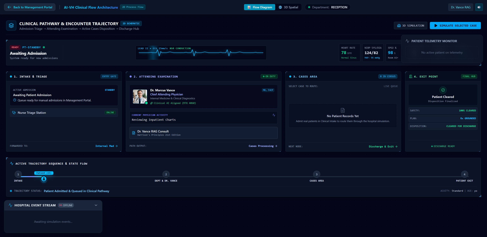

# AI Virtual Hospital (AI-VH) : Visual Interface Catalog

This directory contains high-resolution (1920×1080 / HiDPI) screenshots capturing every routed view, portal workspace, specialist modal, and clinical telemetry dashboard defined in the AI Virtual Hospital platform.

---

## Summary of Captured Views

| # | View Title | Route Slug | File Name | Size |
|---|---|---|---|---|
| 01 | **Case Intake & Emergency Triage Admission Matrix** | `/ (tab: INTAKE)` | [`01_case_intake_and_triage.png`](./01_case_intake_and_triage.png) | 204.8 KB |
| 02 | **Patient Directory, Census & Electronic Health Record Matrix** | `/ (tab: PATIENTS)` | [`02_patient_directory.png`](./02_patient_directory.png) | 211.4 KB |
| 03 | **Hospital Medical Staff Directory & Credentialing** | `/ (tab: STAFF)` | [`03_hospital_staff_directory.png`](./03_hospital_staff_directory.png) | 361.7 KB |
| 04 | **Autonomous Clinical Reports & Physician Review Console** | `/ (tab: REPORTS)` | [`04_clinical_reports_and_reviews.png`](./04_clinical_reports_and_reviews.png) | 422.6 KB |
| 05 | **Harrison's 21st Edition Semantic Vector RAG Explorer** | `/ (tab: KNOWLEDGE)` | [`05_harrison_vector_rag.png`](./05_harrison_vector_rag.png) | 337.8 KB |
| 06 | **Reinforcement Learning Policy Benchmark Portal** | `/ (tab: BENCHMARK)` | [`06_rl_policy_benchmark_portal.png`](./06_rl_policy_benchmark_portal.png) | 102.7 KB |
| 07 | **RL DPO Policy Benchmark & Comparative Analytics Console** | `modal-policy-benchmark` | [`07_policy_benchmark_modal_console.png`](./07_policy_benchmark_modal_console.png) | 408.4 KB |
| 08 | **RL DPO Preference Dataset & Clinical Safety Audit Corpus** | `modal-rl-dataset` | [`08_rl_dataset_corpus_modal.png`](./08_rl_dataset_corpus_modal.png) | 105.0 KB |
| 09 | **Dr. Marcus Vance Attending RAG Specialist Consultation Modal** | `modal-doctor-chat` | [`09_dr_marcus_vance_consult_modal.png`](./09_dr_marcus_vance_consult_modal.png) | 191.9 KB |
| 10 | **Patient Journey Graph & Clinical Flow Architecture** | `/?tab=JOURNEY` | [`10_clinical_flow_architecture_diagram.png`](./10_clinical_flow_architecture_diagram.png) | 269.4 KB |

---

## Detailed View Previews & Descriptions

### 01. Case Intake & Emergency Triage Admission Matrix
- **Route / Trigger**: `/`
- **File**: [`01_case_intake_and_triage.png`](./01_case_intake_and_triage.png)
- **Description**: 5-Level Emergency Severity Index (ESI) admission dashboard, baseline vitals telemetry seed matrix, and clinical scenario presets.

---

### 02. Patient Directory, Census & Electronic Health Record Matrix
- **Route / Trigger**: `/?tab=PATIENTS`
- **File**: [`02_patient_directory.png`](./02_patient_directory.png)
- **Description**: Master inpatient census table with real-time acuity indicators, department badges, and full EHR chart drawer access.

---

### 03. Hospital Medical Staff Directory & Credentialing
- **Route / Trigger**: `/?tab=STAFF`
- **File**: [`03_hospital_staff_directory.png`](./03_hospital_staff_directory.png)
- **Description**: Roster of active clinical agents and human physicians, department filter controls, and Attending Physician profiles.

---

### 04. Autonomous Clinical Reports & Physician Review Console
- **Route / Trigger**: `/?tab=REPORTS`
- **File**: [`04_clinical_reports_and_reviews.png`](./04_clinical_reports_and_reviews.png)
- **Description**: Attending review console with diagnostic confidence gauges, differential diagnoses, treatment regimens, and RL DPO evaluation.

---

### 05. Harrison's 21st Edition Semantic Vector RAG Explorer
- **Route / Trigger**: `/?tab=KNOWLEDGE`
- **File**: [`05_harrison_vector_rag.png`](./05_harrison_vector_rag.png)
- **Description**: Internal medicine vector knowledge explorer indexed across 47,806 semantic chunks with chapter filters and cosine similarity meters.

---

### 06. Reinforcement Learning Policy Benchmark Portal
- **Route / Trigger**: `/?tab=BENCHMARK`
- **File**: [`06_rl_policy_benchmark_portal.png`](./06_rl_policy_benchmark_portal.png)
- **Description**: Overview portal highlighting Base Foundation Model vs. RL DPO Aligned Model clinical reward deltas and benchmark launchers.

---

### 07. RL DPO Policy Benchmark & Comparative Analytics Console
- **Route / Trigger**: `/ (Modal: PolicyBenchmarkModal)`
- **File**: [`07_policy_benchmark_modal_console.png`](./07_policy_benchmark_modal_console.png)
- **Description**: Side-by-side comparative clinical evaluation across diagnostic accuracy, treatment safety compliance, and contraindication avoidance.

---

### 08. RL DPO Preference Dataset & Clinical Safety Audit Corpus
- **Route / Trigger**: `/ (Modal: RLDatasetModal)`
- **File**: [`08_rl_dataset_corpus_modal.png`](./08_rl_dataset_corpus_modal.png)
- **Description**: Supervised preference pairs with chosen vs. rejected clinical rationales, reward weights, and safety-critical contraindication audits.

---

### 09. Dr. Marcus Vance Attending RAG Specialist Consultation Modal
- **Route / Trigger**: `/ (Modal: DoctorChatModal)`
- **File**: [`09_dr_marcus_vance_consult_modal.png`](./09_dr_marcus_vance_consult_modal.png)
- **Description**: Interactive clinical dialogue grounded in Harrison's 21st Edition evidence with Dr. Vance avatar, model telemetry, and prompt shortcuts.

---

### 10. Patient Journey Graph & Clinical Flow Architecture
- **Route / Trigger**: `/?tab=JOURNEY` or header **Patient Journey Graph** button
- **File**: [`10_clinical_flow_architecture_diagram.png`](./10_clinical_flow_architecture_diagram.png)
- **Description**: Real-time 2D multi-station encounter trajectory, Lead II ECG vitals telemetry sweep, acute care milestone state machines, and department station routing.

